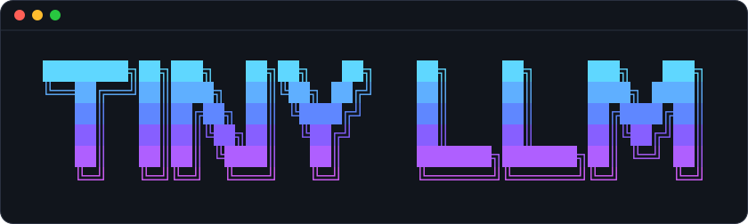
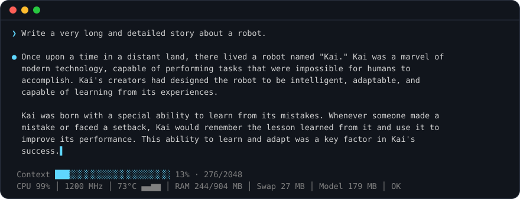
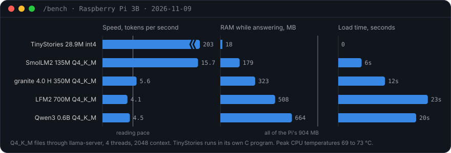
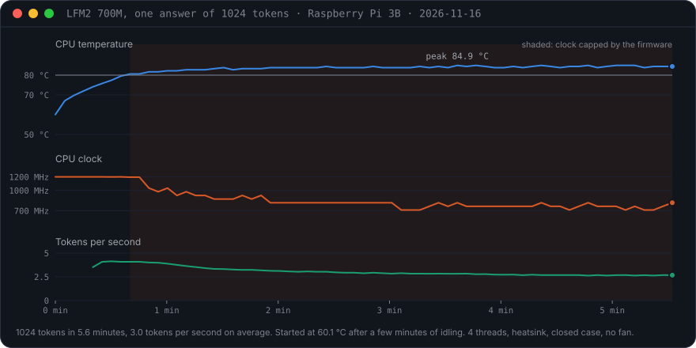

<p align="center">
  
</p>

<p align="center">
  <b>Chat with small language models on a Raspberry Pi 3B, right in your terminal.</b><br>
  GGUF models through llama.cpp · a built-in TinyStories model in plain C · live CPU, RAM and temperature
</p>

<p align="center">
  
  
  
  
</p>

<p align="center">
  <a href="#what-this-is-and-what-it-is-not">About</a> ·
  <a href="#features">Features</a> ·
  <a href="#quick-start">Quick start</a> ·
  <a href="#installation">Installation</a> ·
  <a href="#commands">Commands</a> ·
  <a href="#measurements">Measurements</a> ·
  <a href="#tests">Tests</a> ·
  <a href="#licences">Licences</a>
</p>

---

<p align="center">
  
</p>

## What this is, and what it is not

This is a hobby project. The question behind it was simple: how far does a Raspberry Pi 3B from 2016, with four slow cores, 1 GB of RAM and no GPU, get with today's small language models? The answer is in the [measurements](#measurements): a little further than expected, and nowhere near useful.

- **Not an assistant.** The models that fit are tiny (135M to 700M parameters, quantized to 4 bits). They invent facts, lose the thread after a few turns and answer at 4 to 16 tokens per second, which is slower than you read. Nothing here should be trusted with real questions.
- **A playground.** It is a good way to see with your own eyes how llama.cpp, GGUF quantization, chat templates, context windows and thermal throttling behave, on hardware where every megabyte and every degree shows.
- **A terminal UI exercise.** Live status rows, streaming Markdown, model switching, benchmarks and a few guard rails for a machine that is always short of memory.

If you want a language model that is actually useful, run it on something else. If you want to watch a 350M-parameter model write a bedtime story at 5 tokens per second while the CPU climbs to 80 °C, read on.

## Features

- **Any small GGUF model.** Drop a file into `models/` and it shows up in `/model`, or fetch one with `/download` from Hugging Face.
- **Live status while it answers.** CPU load, RAM, CPU temperature with a short trend, and the throttling flags from `vcgencmd`.
- **Built-in TinyStories.** A 28.9M-parameter model that runs in a small C program at about 200 tokens per second and needs only 18 MB of RAM.
- **Benchmarks on board.** `/bench` compares load time, speed, RAM and peak temperature of all models and keeps the results with the date.
- **Context without surprises.** `/compact` frees space without asking a model. It keeps everything you said plus the latest exchange and drops older answers, because summaries written by these small models lost or invented facts.
- **Share it in your network.** `--serve` offers a model with the llama.cpp web interface to every device at home.
- **Clean shutdown.** Model processes end together with Tiny LLM, even after a lost SSH connection.

## Quick start

```sh
tinyllm                                 # chat in the terminal, starts with the last model used
tinyllm --model SmolLM2                 # start with a model; the start of its name is enough
tinyllm --serve --model SmolLM2         # web interface in the local network on port 8080
```

More options: `--port`, `--temp`, `--top-k` and `--tokens`, see `tinyllm --help`.

> [!WARNING]
> `--serve` has no access control. Anyone in your local network can use the model. Do not forward the port to the internet.

## Installation

**You need** a Raspberry Pi 3B (1 GB RAM) with 64-bit Raspberry Pi OS based on Debian 13 (trixie), and a heatsink: long answers bring the Pi 3B above 80 °C, where it starts to throttle. Other Raspberry Pi models are untested.

```sh
sudo apt install git build-essential python3-venv
git clone https://github.com/huko9806/tinyllm.git
cd tinyllm
python3 -m venv .venv
.venv/bin/pip install -r requirements.txt
./build_llama.sh
mkdir -p ~/.local/bin && ln -s "$PWD/tinyllm" ~/.local/bin/tinyllm
```

Tiny LLM runs from wherever you cloned it. The scripts look for the Python environment in `.venv/`, the models in `models/` and `llama-server` in `llama/`, all inside that folder. The symlink lets you type `tinyllm` from anywhere; log out and in again if the shell does not find it yet.

`build_llama.sh` builds `llama-server` from source into `llama/` and removes the build files afterwards. This takes a long time on a Pi 3B: it uses only two jobs, because some files need a lot of RAM to compile, and builds in `~/.cache`, because `/tmp` on the Pi is a small RAM disk. To build another version, pass a llama.cpp tag as the first argument. Tested: llama.cpp commit `cd959ba`.

### TinyStories

The C code is included: `tinystories_pi.c`, plus `llm.h` and `vocab.h` from [esp32-ai](https://github.com/slvDev/esp32-ai) by Viacheslav Sierbov, the project that runs this model on an ESP32-S3. The model files `model.bin`, `tokenizer.json` and `metadata.json` are on Hugging Face at [slvDev/esp32-ai-tinystories](https://huggingface.co/slvDev/esp32-ai-tinystories). Put them into `tinystories/` and build the program:

```sh
cd tinystories
for f in model.bin tokenizer.json metadata.json; do
  curl -L -o "$f" "https://huggingface.co/slvDev/esp32-ai-tinystories/resolve/main/$f"
done
cc -O3 -mcpu=cortex-a53 -Wall -Wno-unused-function -o tinystories_pi tinystories_pi.c -lm
```

> [!NOTE]
> The TinyStories model files are not part of this repository, but Tiny LLM needs them. It starts with TinyStories on the first run and falls back to it when a GGUF model cannot be loaded. TinyStories continues English stories; it does not chat.

### GGUF models

Put GGUF files into `models/` inside the Tiny LLM folder, or download them inside Tiny LLM with `/download <repo> [file]`. On 1 GB of RAM, files up to about 470 MB are practical. Tested with Q4_K_M versions of:

| Model | Licence |
|---|---|
| [SmolLM2 135M Instruct](https://huggingface.co/HuggingFaceTB/SmolLM2-135M-Instruct) | Apache 2.0 |
| [granite 4.0 H 350M](https://huggingface.co/ibm-granite/granite-4.0-h-350m) | Apache 2.0 |
| [LFM2 700M](https://huggingface.co/LiquidAI/LFM2-700M) | LFM Open License v1.0 |
| [Qwen3 0.6B](https://huggingface.co/Qwen/Qwen3-0.6B) | Apache 2.0 |

## Commands

| Command | What it does |
|---|---|
| `/model`, `/model 2` | List all models, switch by number or name |
| `/temp 0.8` | Randomness from 0 (always the same) to 2 (very wild) |
| `/topk 40` | Candidates per token, 1 to 100 |
| `/tokens 200` | Maximum answer length in tokens, remembered per model |
| `/think on\|off` | Let models that can reason think before answering |
| `/system text` | Set rules for the model, `/system off` removes them |
| `/compact` | Free context: keep what you said and the latest exchange |
| `/clear` | Clear the screen and forget the conversation |
| `/save name`, `/load name` | Save the conversation as JSON and Markdown, continue it later |
| `/bench` | Compare speed, RAM and heat of all models |
| `/download repo [file]` | Get a GGUF model from Hugging Face |
| `/heat on\|off` | Use fewer cores after an answer above 80 °C |
| `/retry` | Answer the last message again |
| `/copy` | Copy the last answer (OSC 52), also saved as a file |
| `/info` | Facts and measurements of the current model |
| `@path` | Add a text file to your message, e.g. `@notes.txt` |
| `Alt+Enter` | New line inside a message |
| `Ctrl+C` | Stop the running answer |
| `/quit`, `Ctrl+D` | Quit |

The context is fixed at 2048 tokens because of the RAM. Settings, input history, saved chats and the last copied answer live in `~/.config/tinyllm`; set `TINYLLM_CONFIG` to use another folder. The log of the model server is `~/.cache/tinyllm/llama-server.log`.

## Measurements

All numbers come from one Raspberry Pi 3B with a heatsink in a closed case without a fan, running the models on 4 threads with a context of 2048 tokens. The charts are drawn by [assets/make_charts.py](assets/make_charts.py) from the values below.

<p align="center">
  
</p>

Only SmolLM2 and TinyStories answer faster than you read. The three larger models take 4 to 6 seconds for a sentence, and Qwen3 alone leaves less than 250 MB for everything else. `/bench` on 2026-11-09:

| Model | Load | Tokens/s | RAM | Peak |
|---|--:|--:|--:|--:|
| TinyStories (28.9M, int4) | 0 s | **203** | 18 MB | – |
| SmolLM2 135M Q4_K_M | 6 s | **15.7** | 179 MB | 70 °C |
| granite 4.0 H 350M Q4_K_M | 12 s | **5.6** | 323 MB¹ | 73 °C |
| LFM2 700M Q4_K_M | 23 s | **4.1** | 508 MB | 69 °C |
| Qwen3 0.6B Q4_K_M | 20 s | **4.5** | 664 MB | 71 °C |

¹ grows to about 700 MB during a chat.

The short `/bench` answers stay below 75 °C. A long answer does not. This is one answer of 1024 tokens from LFM2 on 2026-11-16, sampled every 5 seconds with `vcgencmd` (the data is in [assets/thermal-run.csv](assets/thermal-run.csv)):

<p align="center">
  
</p>

The Pi reaches 80 °C after 40 seconds. From then on the firmware caps the clock, first to about 900 MHz and soon to about 770 MHz, and the answer slows from 4 to 2.5 tokens per second. The 4.1 tokens per second from `/bench` are what you get in the first minute. With `/heat on`, Tiny LLM restarts the model server after an answer with one core less above 80 °C (at least 2) and with one more below 70 °C, which keeps the Pi cooler at the price of speed. A fan would help more.

## Tests

The tests run on a PC and drive Tiny LLM on the Pi over SSH. They need:

- an SSH host alias `pi` with key login
- an installed copy on the Pi with the `tinyllm` symlink in `~/.local/bin`, as in [Installation](#installation); the tests find the folder through that command, or you set `TINYLLM_PI_DIR` to it
- SmolLM2 135M and granite 4.0 H 350M in `models/`
- internet access for one test that downloads a small model from Hugging Face

All tests use `TINYLLM_CONFIG=/tmp/tinyllm-test`, so your own settings stay untouched.

```sh
python3 -m venv tests/.venv && tests/.venv/bin/pip install pyte
tests/run_all.sh        # about 20 minutes, outputs in tests/out/
```

`unit_*.py` run on the Pi. `tui_*.py` and `serve_network.py` read the screen with [pyte](https://github.com/selectel/pyte). `run_all.sh` stops as soon as someone starts Tiny LLM on the Pi.

## Licences

| Part | Licence |
|---|---|
| Tiny LLM | MIT, see [LICENSE](LICENSE) |
| `tinystories/llm.h`, `tinystories/vocab.h` ([esp32-ai](https://github.com/slvDev/esp32-ai), Viacheslav Sierbov) | MIT, see [tinystories/Licence](tinystories/Licence) |
| TinyStories weights and tokenizer ([slvDev/esp32-ai-tinystories](https://huggingface.co/slvDev/esp32-ai-tinystories), not included) | MIT |
| TinyStories training data ([roneneldan/TinyStories](https://huggingface.co/datasets/roneneldan/TinyStories)) | CDLA-Sharing-1.0 |
| [llama.cpp](https://github.com/ggml-org/llama.cpp) (built from source, not included) | MIT |
| GGUF models | their own licences, see [GGUF models](#gguf-models) |
